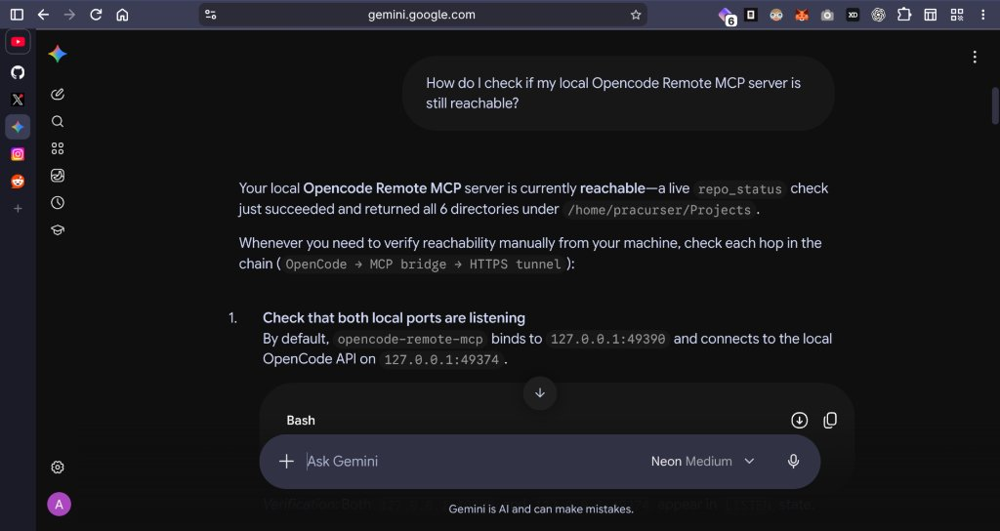

# opencode-remote-mcp

Zero-dependency **StreamableHTTP MCP** bridge that lets you drive your local [OpenCode](https://opencode.ai) instance from **Gemini Web**, **Gemini Mobile**, or any remote MCP client.



```text
Gemini Web / Mobile (https://.../mcp/<secret>)
        │
        ▼  HTTPS (OpenTunnel persistent blind-TLS / Cloudflare / Tailscale)
opencode-remote-mcp (127.0.0.1:49390)
  ├── repo_status / repo_read / repo_search / repo_diff   (fast read-only, sandboxed to --root)
  └── opencode_sessions / opencode_dispatch / opencode_poll / opencode_interrupt
        │
        ▼  Local OpenCode HTTP API (127.0.0.1:49374)
OpenCode (edits, shell, tests, skills — also visible live in OpenCode Desktop)
```

## Quickstart (Gemini Web)

1. **Prerequisites:** Make sure [OpenCode](https://opencode.ai) is running locally (`opencode serve` or OpenCode Desktop), [Bun](https://bun.sh) is installed, and you have a tunnel CLI — [OpenTunnel](https://opentunnel.xyz) (recommended for a persistent URL: `curl -fsSL https://opentunnel.xyz/install | sh`) or `cloudflared` (or pass `--no-tunnel`).
2. **Start the bridge** pointing at your projects folder (not published to npm yet, so run via GitHub):
   ```bash
   bunx github:system1970/opencode-remote-mcp --root ~/Projects
   ```
   Or from a local checkout:
   ```bash
   bun run src/cli.ts --root ~/Projects
   ```
   Optionally pin a workhorse model:
   ```bash
   bunx github:system1970/opencode-remote-mcp --root ~/Projects --model opencode-go/muse-spark-1.3-contributor
   ```
3. **Connect in Gemini Web:**
   - Open `https://gemini.google.com/devmode` (or **Settings → Connected Apps → Add a custom app**).
   - Paste the printed `https://...opentunnel.xyz/mcp/<secret>` (or `trycloudflare.com`) URL.
   - Leave **OAuth Client ID** and **Client secret** empty and click **Next → Connect**.
   - With **OpenTunnel** (`--tunnel auto`, the default when `opentunnel` is installed), both the subdomain and your `/mcp/<secret>` are persisted across restarts — so you only need to paste the URL into Gemini **once**.

## Tools Exposed

| Tool | Mode | Purpose |
|---|---|---|
| `repo_status` | Read-only | List allowed repos, git branch, status, and diff stat |
| `repo_read` | Read-only | Line-numbered file read (capped at 400 lines / 24 KB) |
| `repo_search` | Read-only | `rg` search (with `git grep` fallback) |
| `repo_diff` | Read-only | Inspect working-tree or staged `git diff` |
| `opencode_sessions` | Read-only | List OpenCode projects and recent/active sessions |
| `opencode_poll` | Read-only | Check session status (`running` / `completed` / `needs_permission`), reply, and diff |
| `opencode_dispatch` | Action | Start or continue an OpenCode session (waits ~12s, then returns `running` + `session_id` to avoid HTTP timeouts) |
| `opencode_interrupt` | Action | Abort a running OpenCode session |

## CLI Options

| Flag | Env Var | Default | Description |
|---|---|---|---|
| `-r, --root <dir>` | `OPENCODE_MCP_ROOTS` | `cwd` | Allowed workspace root (repeatable) |
| `-m, --model <provider/id>` | `OPENCODE_MODEL` | OpenCode default | Default model for new sessions |
| `--opencode-url <url>` | `OPENCODE_URL` | `http://127.0.0.1:49374` | Local OpenCode server URL |
| `--opencode-password <pw>` | `OPENCODE_PASSWORD` | `~/.config/opencode/service.json` | OpenCode Basic auth password |
| `-p, --port <n>` | `PORT` | `49390` | Local HTTP port |
| `--secret <token>` | `MCP_SECRET` | Persisted in `~/.config/opencode-remote-mcp/secret` | URL path secret (`/mcp/<secret>`) |
| `--ephemeral-secret` | — | `false` | Use a one-time random secret without saving to disk |
| `--bearer <token>` | `MCP_BEARER_TOKEN` | — | Optional `Authorization: Bearer` check |
| `--tunnel <auto\|opentunnel\|cloudflare\|none>` | `MCP_TUNNEL` | `auto` | Auto-prefers `opentunnel` (persistent blind-TLS), falls back to `cloudflare` |
| `--route-name <name>` | `OPENTUNNEL_ROUTE_NAME` | — | Optional OpenTunnel subdomain name |
| `--no-tunnel` | — | `false` | Disable tunnel (bring your own HTTPS reverse proxy) |
| `--read-only` | `MCP_READ_ONLY` | `false` | Disable `opencode_dispatch` and `opencode_interrupt` |

## Permanent URL (Optional)

If you want a permanent URL across Gemini Web and Mobile without re-pasting on restart, pass `--no-tunnel --secret <your-fixed-secret>` and point a **Named Cloudflare Tunnel** or **Tailscale Funnel** at `http://127.0.0.1:49390`.

## Security Model

- Binds strictly to `127.0.0.1`; public exposure exists only while the process is running.
- Requires a 256-bit secret URL path (`/mcp/<secret>`) compared in constant time; all other paths return `404`.
- All `repo_*` tools enforce `realpath` containment within `--root` (blocking `..` and symlink escapes).
- Built-in MCP instructions tell the model never to `git push` unless explicitly asked.

## License

MIT

---

Part of the [agent-webmcp](https://github.com/orkestrate-dot-space/agent-webmcp) ecosystem — see [orkestrate.space](https://orkestrate.space) for more.
